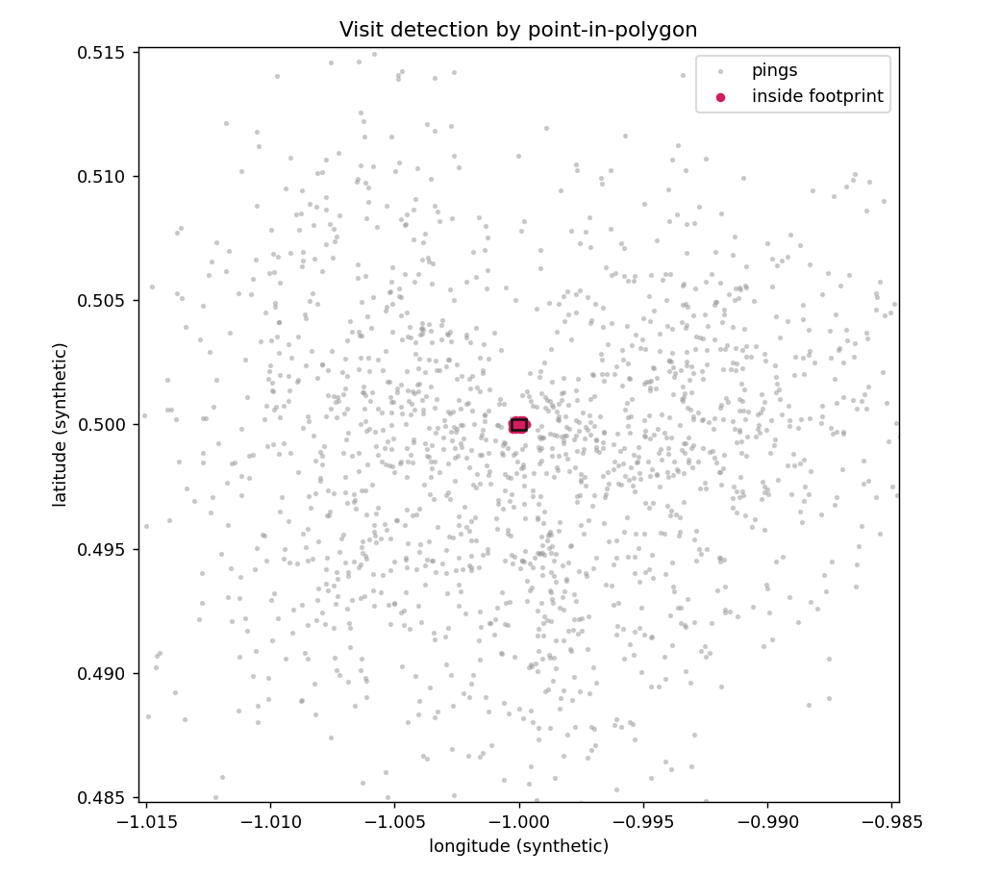
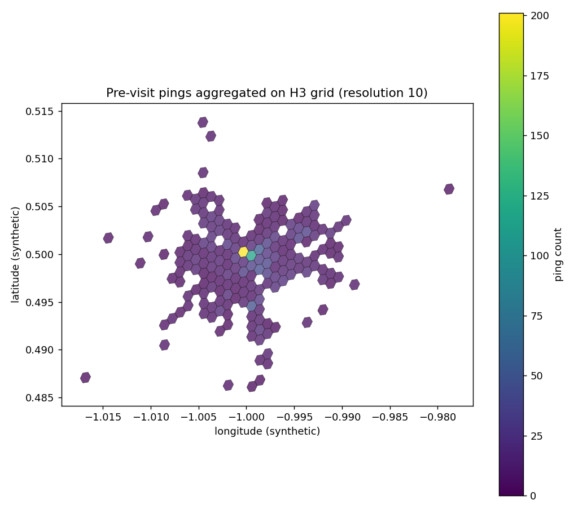
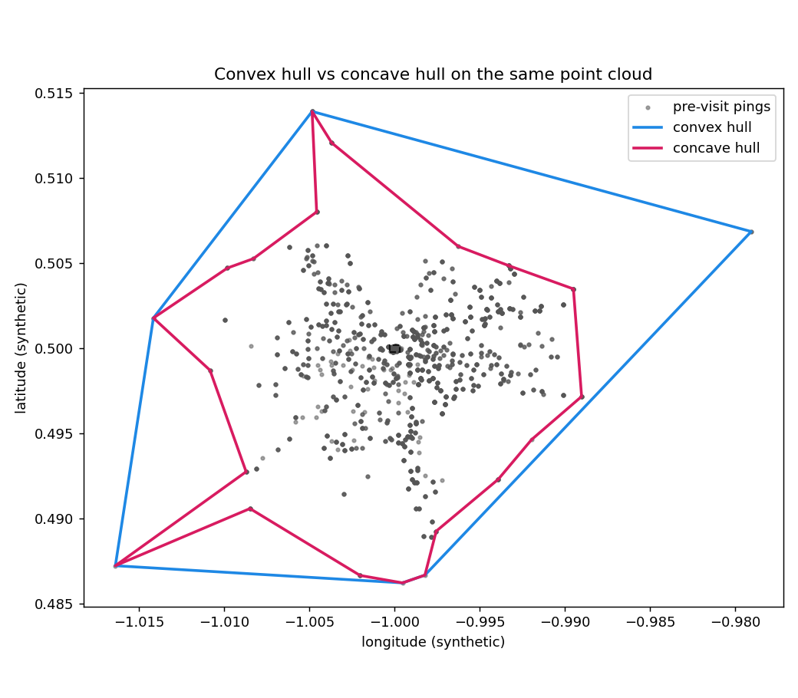

# Measuring real-world catchment areas from mobile location data

### A comparative study of grid-based and adaptive geometry for visitor mobility analysis

---

## The question

A quick-service restaurant chain wanted to understand the movement patterns around its locations: where visitors come from before a visit, where they go afterward, and how those patterns differ between staff and customers.

Two outputs were needed:

1. **Catchment geometry** — a structured representation of the pre-visit and post-visit areas of influence for each location, across several time horizons.
2. **Visitor segmentation** — a way to separate employees from customers without access to any staff records.

The second requirement is what makes the problem interesting. There is no ground truth. Nobody can hand you a labelled set of "this device belongs to an employee." Whatever method you choose has to be defensible on its own reasoning, not on a validation score.

---

## The data

**Device pings.** One row per GPS observation: anonymised device identifier, latitude, longitude, UTC timestamp. The working sample was roughly 86,000 pings; the full dataset ran to about 1.5 million.

**Locations.** Fifteen sites in the study area, each with coordinates and a WKT polygon describing the physical establishment footprint.

**What was wrong with it.** Timestamps arrived in mixed formats and had to be parsed permissively. A non-trivial share of the establishment polygons were malformed — duplicate consecutive vertices, unclosed rings, fewer than three distinct points after deduplication, and in some cases self-intersections. A repair function attempted to close and clean each polygon and rejected the ones that could not be salvaged. GPS noise placed some pings far outside the study area; these were removed by bounding-box filter before any expensive geometry ran.

---

## Approach

### Visit detection

Each ping is tested for containment within an establishment polygon using exact point-in-polygon geometry.

The naive implementation is a cross product of every ping against every location, and it does not finish in reasonable time: 86,000 pings against 15 polygons with exact containment turns a two-minute job into a two-hour one. A bounding-box pre-filter eliminates the overwhelming majority of candidate pairs before any exact test runs. This is the single most important performance decision in the pipeline, and it costs about ten lines of code.

### Separating staff from customers

With no labels available, a supervised model was not an option, and unsupervised clustering would have required defending a choice of cluster count against no ground truth. The method chosen is a set of explicit behavioural rules, which has the advantage of being arguable in front of a non-technical stakeholder.

A device is classified as staff only if it clears two gates:

**Gate one — repeat presence.** The device must appear on two or more distinct days. A single visit is always a customer.

**Gate two — two of three behavioural signals:**

| Signal | Threshold | Reasoning |
|---|---|---|
| Long dwell | At least one visit of 2+ hours | Customers rarely stay that long |
| High frequency | 3+ visits in the period | Repeat presence beyond coincidence |
| Schedule regularity | Standard deviation of visit hour under 4 hours | Shift work is consistent; casual visits are not |

Requiring two of three rather than all three accommodates the real variation in shift patterns — a part-time worker may fail the frequency test while clearly passing dwell and regularity.

### Catchment geometry, approach one: hexagonal grid

For each detected visit, pings from the same device are extracted in a window before the visit and a window after it, at four horizons: 20, 45, 90 and 180 minutes.

Each ping is mapped to a hexagonal cell on a fixed global grid at a resolution of roughly 0.7 km² per cell. Cells are aggregated by ping count and normalised per location, producing an intensity surface.

**Why that resolution.** One level finer drops to about 0.1 km² per cell, where GPS noise begins to dominate the signal within each cell. One level coarser rises to about 5 km², which flattens the contour entirely. The chosen level corresponds to neighbourhood scale, which is the scale the business question is asked at.

**Why four windows rather than one.** Twenty minutes captures the immediate approach. Forty-five captures the neighbourhood pattern. Ninety captures the regional pattern. One hundred and eighty approximates the day's trajectory. A single window would answer only one of those, and the staff-versus-customer question depends on seeing how the pattern changes as the horizon widens.

**Why both directions.** The pre-visit window reveals origin — where people live or work. The post-visit window reveals destination — whether they return home or continue to another stop. Both are needed for the full picture.

### Catchment geometry, approach two: adaptive hulls

The hexagonal approach has a structural weakness that becomes obvious once you look at the maps. A fixed grid imposes its own geometry on the result. Where pings follow a curving arterial road, the hexagons covering that road also cover a great deal of empty ground on either side. The shape you see is partly the shape of the grid, not the shape of the behaviour.

The second approach replaces the grid with polygons fitted to the actual point cloud. For each location, device, direction and time window with at least three points, two polygons are generated:

**Convex hull** — the smallest convex polygon containing every point. Always computable, always valid, and systematically over-inclusive when the true distribution is concave.

**Concave hull (alpha shape)** — follows the point cloud more closely at the cost of depending on a shape parameter, and occasionally failing outright on collinear or degenerate configurations.

Rather than choosing between them, the pipeline computes both and records which one succeeded for each case. The consumer of the output selects according to the use case: convex when a conservative over-estimate is acceptable, concave when the shape itself matters. There is no objective criterion for "the correct shape" of a catchment area, so imposing one in code would have been a false precision.

The shape parameter for the concave hull was left fixed rather than tuned per location. Tuning would have required exactly the ground truth that does not exist.

---

## Validation

Without labels, validation has to lean on internal consistency and order-of-magnitude reasoning.

**Order of magnitude.** 86,000 pings yielded roughly 985 visits — about one percent. That ratio is consistent with expectation: most of a device's pings are not inside any point of interest. A result an order of magnitude higher would have indicated a containment bug rather than a discovery.

**Spatial plausibility.** Early output was checked against a basemap to confirm that pre-visit and post-visit areas fell on residential streets around each site, rather than in implausible locations.

**Segmentation sanity.** The sample produced 290 staff and 695 customers, a 29% staff share. That is high, and the honest reading is that a sample weighted toward repeat visits inflates it; the ratio fell on the full dataset. Reporting the figure with that caveat is more useful than reporting it bare.

**Geometry stability.** Cell and polygon counts were checked for consistency between runs. A sudden change signals silent failure in generation rather than a change in the data.

**Validity checking.** Every generated polygon is tested for topological validity before serialisation. Invalid geometry is reported and sent through a repair pass rather than written out.

**Coverage gaps as findings.** Two of fifteen locations produced no activity at all. The correct interpretation is not "no visitors" but "these establishment polygons need auditing upstream" — a data quality finding surfaced by the analysis rather than a result of it.

---

## Results

| Measure | Value |
|---|---|
| Device pings processed | ~86,000 (sample); ~1.5M (full) |
| Visits identified | 985 |
| Segmentation | 290 staff (29.4%) / 695 customers (70.6%) |
| Grid cells generated | 322, intensity range 3.8%–100% |
| Locations with activity | 13 of 15 |
| Runtime | 2–3 min (sample); 30–60 min (full) |

The adaptive-hull output fits the observed distribution noticeably more tightly than the grid, particularly along linear features where the fixed grid covers substantial empty ground.

Deliverables were standalone interactive HTML maps with filtering by location, time window and direction — chosen deliberately over a data format optimised for downstream pipelines, because the immediate audience opens a file in a browser rather than reading Parquet.

---

## Performance work, and keeping it separable

The second iteration was a performance refactor: vectorising the coordinate extraction that accounted for most of the runtime, replacing row-wise application with vectorised containment testing, replacing Python loops over devices with grouped aggregation, and reusing computed results instead of recomputing them for daily counts. The reported speed-up was three to five times.

The discipline that mattered more than the speed-up: **performance changes and data-quality changes were kept in separate work, each proving it left the output unchanged before merging.** Regression tests ran both versions against the same input and compared outputs for equivalence.

This matters because the two kinds of change are easy to confuse and impossible to untangle afterwards. If a refactor silently alters a result, and a data-quality fix lands in the same change, there is no way to tell which one moved the number. Separating them means every refactor can be proven neutral and every quality fix can be attributed.

That principle — prove the change is neutral before accepting it — later became the foundation of a deterministic verification layer in a much larger production pipeline, where an automated decision is only accepted if an independent check re-derives it from the underlying signals.

---

## What I would do differently

**Instrument the comparison properly.** The qualitative observation that hulls fit better than hexagons is visible on the maps but was never quantified. A measure of enclosed empty area per approach would have turned a judgement call into a result.

**Build the sample harness first.** It was written partway through, after the need for controlled test inputs became obvious. It should have been the first thing built.

**Repair geometry at ingestion.** Polygon repair arrived as a later pass over data that had already been processed. Validating and repairing input geometry at the point of entry would have avoided reprocessing.

---

## Reproduction

A synthetic-data script in this repository reproduces the method at small scale: visit detection by point-in-polygon, hexagonal grid against convex and concave hulls, and an interactive map as output. All coordinates are synthetic.

*Pings around a fictional establishment, with those inside the footprint highlighted.*

*Pre-visit pings aggregated onto an H3 grid at resolution 10, intensity by ping count.*

*Convex hull (over-inclusive) and concave hull (closer to the point distribution) over the same pre-visit cloud.*

An interactive version of the same output is at [`docs/interactive_map.html`](docs/interactive_map.html).
